<a href="https://geekplux.com"><picture><source media="(prefers-color-scheme: dark)" srcset="assets/header-dark.svg"></picture></a>

 

<a href="https://markvis.js.org"><picture><source media="(prefers-color-scheme: dark)" srcset="assets/markvis-dark.svg"></picture></a>
<a href="https://vert.geekplux.com"><picture><source media="(prefers-color-scheme: dark)" srcset="assets/vert-dark.svg"></picture></a>
<a href="https://explorable.geekplux.com"><picture><source media="(prefers-color-scheme: dark)" srcset="assets/explorable-dark.svg"></picture></a>
<a href="https://reasontrail.geekplux.com"><picture><source media="(prefers-color-scheme: dark)" srcset="assets/reasontrail-dark.svg"></picture></a>
<a href="https://reporivers.geekplux.com"><picture><source media="(prefers-color-scheme: dark)" srcset="assets/repo-rivers-dark.svg"></picture></a>
<a href="https://pagelapse.geekplux.com"><picture><source media="(prefers-color-scheme: dark)" srcset="assets/pagelapse-dark.svg"></picture></a>
<a href="https://spec2skill.geekplux.com"><picture><source media="(prefers-color-scheme: dark)" srcset="assets/spec2skill-dark.svg"></picture></a>
<a href="https://worldlines.geekplux.com"><picture><source media="(prefers-color-scheme: dark)" srcset="assets/worldlines-dark.svg"></picture></a>
<a href="https://timeline-sankey.vercel.app"><picture><source media="(prefers-color-scheme: dark)" srcset="assets/timeline-sankey-dark.svg"></picture></a>
<a href="https://github.com/geekplux/cv_resume"><picture><source media="(prefers-color-scheme: dark)" srcset="assets/cv_resume-dark.svg"></picture></a>

 

Off the keyboard: bouldering (up to V9), tennis (I can rally; I can't serve yet), ukulele, and a ten-hole harmonica.

[geekplux.com](https://geekplux.com) &ensp; [X](https://x.com/geekplux) &ensp; [ping@geekplux.com](mailto:ping@geekplux.com)
